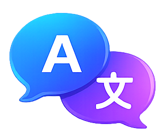
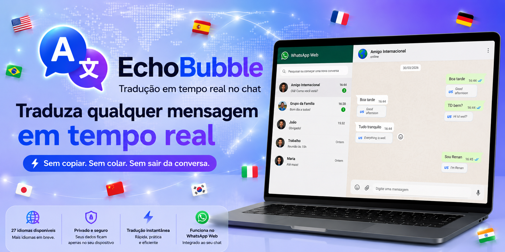

  

<b>Tradução automática em tempo real para o WhatsApp Web.</b> 
Converse em qualquer idioma sem sair do chat.

---

## ✨ Funcionalidades

- 🌍 Tradução automática das mensagens
- 💬 Tradução exibida abaixo de cada mensagem
- ⚡ Tradução em tempo real
- 🎯 Interface leve e discreta
- 🧠 Cache inteligente de traduções
- 🌐 Suporte para diversos idiomas
- 🖥️ Desenvolvido para WhatsApp Web

---

## 📷 Demonstração

  

---

## 🌎 Idiomas

Atualmente o EchoBubble suporta **27 idiomas**.

Novos idiomas serão adicionados nas próximas versões.

---

## 📥 Instalação

Disponível na Chrome Web Store:
https://chromewebstore.google.com/detail/echobubble/nihgeeklpgnenhaopikdbaoeljlajakj

---

## ⚠️ Limite diário

A tradução usa o serviço gratuito MyMemory, com limite de **5.000 caracteres por dia**.
Informando seu e-mail (opcional) no popup da extensão, o limite sobe para **50.000 por dia**.

---

## 📌 Tecnologias

- JavaScript
- HTML
- CSS
- Chrome Extensions Manifest V3
- MyMemory Translation API

---

## 📅 Roadmap

- ✅ Tradução automática
- ✅ Seleção de idioma
- ✅ Cache inteligente
- ✅ Publicação na Chrome Web Store
- ✅ E-mail opcional para ampliar o limite diário
- 🔄 Mais idiomas
- 🔄 Mais APIs de tradução
- 🔄 Tradução das mensagens enviadas
- 🔄 Melhorias de desempenho

---

## 👨‍💻 Autor

Desenvolvido por **Renan Casagrande**.

Projeto open source.
